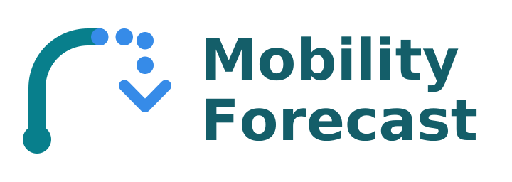

  <picture>
    <source media="(prefers-color-scheme: dark)" srcset="assets/brand/logo-dark.svg">
    
  </picture>

# Mobility Forecast

Explainable distance forecasts for your Home Assistant vehicles.

[Install](#installation) · [Documentation](docs/index.md) · [Releases](https://github.com/LickABrick/mobility-forecast/releases) · [Support](docs/troubleshooting.md)

## What is Mobility Forecast?

Mobility Forecast predicts how far your vehicle is likely to travel using its
odometer history. Optionally, it includes planned journeys from Home Assistant
calendars and estimates when an electric vehicle may need charging.

Basic mileage forecasting works locally, without a calendar, external account or
EV sensors. External routing and charging-location services are contacted only
when their corresponding optional features are enabled.

Each configured vehicle gets its own device, forecasts and retained history.
Predictions are estimates, not observations or promises about future travel.

## Features

- **Mileage forecasting:** today, tomorrow, rolling seven/thirty days and annual distance.
- **Calendar-aware predictions:** chronological journeys, zones, known locations and optional Waze routing.
- **Historical comparisons:** genuine pre-day predictions, actual mileage and accuracy metrics.
- **Optional experimental EV estimates:** reserve-aware range, charging energy, duration and a next charging suggestion.
- **Native Home Assistant:** translated English/Dutch settings, manual sync, diagnostics and Repairs.

## Requirements

- Home Assistant Core **2026.10.2 or newer**; primary tested version: 2026.10.2.
- An available numeric **lifetime cumulative vehicle odometer** in km or mi.
  Daily trip counters, remaining range and walking distance are not suitable.
- Recorder history for that sensor. Excluded/purged observations cannot be recreated.
  Suitable physical-state statistics can supplement retained raw history.
- Optional: calendar entities and Home Assistant's **Waze Travel Time** integration.
- Optional EV: a battery percentage sensor, usable capacity, typical consumption and vehicle AC power.

Development uses Python **3.14.2+**; HA manages Python on HAOS.

## Installation

### HACS custom repository

1. Open HACS → menu → **Custom repositories**.
2. Add `https://github.com/LickABrick/mobility-forecast`, category **Integration**.
3. Download Mobility Forecast and restart Home Assistant.
4. Open **Settings → Devices & services → Add integration → Mobility Forecast**.

Custom repository support is separate from inclusion in the default HACS catalog;
this project does not claim catalog acceptance.

### Manual installation

Copy the entire `custom_components/mobility_forecast` directory into your HA
configuration's `custom_components` directory. Restart HA, then add the integration
as above. For updates, replace the integration directory and restart; keep HA's
private storage intact. Back up before updating.

## Quick start

1. Select the vehicle's cumulative odometer and optionally name the vehicle.
2. Open its device under **Settings → Devices & services → Mobility Forecast**.
3. Find the five expected-distance sensors. Initial `unknown` values are normal.
4. Check **Forecast status**, **Calendar status**, **Sync status** and **Last successful
   sync** on the device. Seven adequately covered days establish the normal baseline;
   verified calendar routes can provide limited preliminary daily estimates sooner.
5. Add an ordinary Entities card. No custom frontend is required.

See [Getting Started](docs/getting-started.md) for learning behavior and recovery.

## Optional features

### Calendars and Waze

Enable **Calendars and routes** in vehicle options. Select calendars and explicitly
choose a Waze region. Known locations resolve appointment aliases; overlapping or
unroutable journeys fall back conservatively. [Calendar guide](docs/calendar-routing.md).

### Mileage comparisons

Use the enabled-by-default **Mileage timeline** sensor to inspect history,
future daily forecasts and measured accuracy. Missing predictions are not invented
afterwards. [Dashboard examples](docs/dashboard.md).

### EV charging estimates

Enable **Electric vehicle → EV setup** only if wanted. Home charging assumptions
and nearby public AC opportunities can inform a next-action recommendation.
No charger or vehicle is controlled. Public discovery is optional and experimental.
[EV guide and limitations](docs/ev-charging.md).

## How predictions work

Historical mileage provides a robust baseline. With enough evidence, weekday
patterns and recent trends adjust it. Calendar distances raise the baseline when
known planned travel is greater; they are not blindly added to it. Incomplete
itineraries use conservative historical fallback. Unknown observations are not zero.

Rolling periods start now; today/tomorrow are local calendar days. Annual distance
is a forward historical expectation, not mileage already driven this year.
[Technical algorithm](docs/developer/forecasting-algorithm.md).

## Privacy

Mileage reconstruction, forecasting and storage run locally in HA. Optional Waze
routing transmits origin/destination addresses or coordinates. Optional public
charging discovery sends destination addresses to PDOK and coordinates to NDW.
These requests do not include calendar titles, descriptions or attendees.

HA calendar integrations may themselves use external services. History, known
locations and cached distances in HA backups remain sensitive, even where route
identifiers are hashed. Downloaded diagnostics omit raw history and destinations;
review any shared logs. No separate Mobility Forecast backend or telemetry is added.

## Important limitations

- Missing or stale odometer observations reduce accuracy; calendar events do not prove which vehicle was used.
- Routing cannot always establish a complete itinerary. Restored calendar distances are provisional pending verification.
- Indicative uncertainty ranges are not calibrated confidence percentages.
- Public chargers are not reserved and future availability cannot be guaranteed.
- EV planning is an experimental first-action heuristic, not a complete weekly optimizer or automatic charging control.

See [troubleshooting and status meanings](docs/troubleshooting.md) and [EV limitations](docs/ev-charging.md#limitations).

## Documentation

Start at the [documentation index](docs/index.md):
[Getting Started](docs/getting-started.md) · [Configuration](docs/configuration.md) ·
[Calendar routing](docs/calendar-routing.md) · [EV charging](docs/ev-charging.md) ·
[Dashboards](docs/dashboard.md) · [Developer guides](docs/developer/index.md).

## Support and contributing

Read [troubleshooting](docs/troubleshooting.md) before reporting an issue.
See [contribution guidelines](CONTRIBUTING.md), [security reporting](SECURITY.md)
and the [license](LICENSE). Never post private destinations or vehicle telemetry.

See [sync progress, diagnostic states and calendar-only estimates](docs/sync-diagnostics.md).
